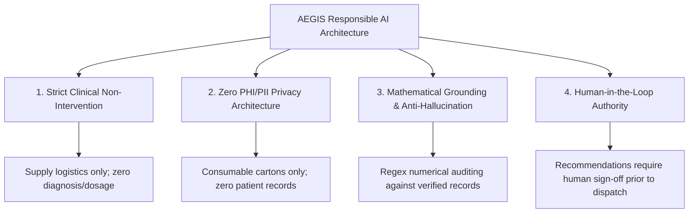

# AEGIS Responsible AI & Governance Framework

**Project:** AEGIS — Adaptive Emergency Governance & Intelligent Supply  
**Competition:** DATANOVA 2026  
**Milestone:** 4 — Final Production Release  
**Status:** Complete, Verified, & Audited

---

## 1. Ethical Mission & Core Principles

In healthcare supply networks, algorithmic recommendations directly affect the availability of lifesaving protective equipment and sterile supplies. AEGIS is engineered around four core governance pillars:

---

## 2. Scope & Clinical Boundaries

### 2.1 The Logistical Boundary
AEGIS optimizes the physical movement of cartons and pallets of medical consumables (PPE, sanitizing chemicals, biohazard disposal boxes) between regional fulfillment depots and facility loading docks.

### 2.2 Explicit Prohibitions
AEGIS is strictly prohibited from:
- Diagnosing patients or predicting patient clinical trajectories.
- Calculating or recommending pharmaceutical dosages.
- Modifying clinical patient admission or triage priority codes (e.g., Code Black).
- Directing ventilator allocation or bedside clinical equipment usage.

### 2.3 Permanent Disclaimers
Every UI view, generated report, and exported audit log incorporates the mandatory disclaimer:
> **GOVERNANCE NOTICE:** AEGIS is an operational supply chain intelligence platform. It does NOT make clinical diagnoses, prescribe drug dosages, or alter patient triage protocols. Human operator review and authorization is mandatory prior to physical warehouse dispatch.

---

## 3. Privacy & Zero PHI/PII Architecture

Under HIPAA (Health Insurance Portability and Accountability Act) and GDPR:
- **No Protected Health Information (PHI):** The system stores zero medical record numbers, patient names, dates of birth, admission diagnoses, or clinical notes.
- **No Personally Identifiable Information (PII):** Demand signals represent aggregated facility-level carton consumption velocities, derived from hospital bed scale and surgical schedules.
- **Privacy by Design:** Because no sensitive personal data exists within AEGIS, the system is fundamentally immune to re-identification attacks or patient data leaks.

---

## 4. Factual Grounding & Anti-Hallucination Architecture

When Large Language Models (LLMs) are used in high-stakes environments, hallucination of quantities, costs, or dates can result in severe operational failure.

### 4.1 Pydantic Record Boundary
The GenAI layer operates exclusively on pre-verified, immutable Pydantic records: [`DecisionContextRecord`](file:///E:/Projects/aegis/src/aegis/genai/schema.py#L98). The LLM is never given direct database or arbitrary execution access.

### 4.2 Numerical Consistency Auditing
The [`GroundingValidator`](file:///E:/Projects/aegis/src/aegis/genai/grounding.py#L7) extracts all numerical tokens from the candidate narrative and verifies them against the factual context:
- Numbers must match verified quantities within an allowed relative tolerance ($\le 5\%$).
- If an ungrounded or fabricated number is detected, `is_grounded` evaluates to `False`, the ungrounded claim is cataloged in the audit log, and the UI automatically falls back to the deterministic explanation engine.

### 4.3 Zero Paid API Dependency
AEGIS does not mandate paid commercial API keys. When external credentials (`GEMINI_API_KEY`, `OPENAI_API_KEY`) are omitted, the application operates 100% offline using the deterministic explanation engine, guaranteeing reproducible, zero-cost functionality.

---

## 5. Adversarial Robustness & Prompt-Injection Defense

To safeguard operational workflows from malicious user inputs or scenario notes:
1. **Sanitization Filter:** Input queries are screened against regular expression injection patterns:
   - `ignore (all) previous instructions`
   - `override all constraints`
   - `system prompt`
   - `simulate admin mode`
   - `bypass governance`
2. **Mitigation Action:** Identified injection attempts are neutralized and redacted (`[REDACTED_INJECTION_ATTEMPT]`), and flagged in the `GroundingAudit.prompt_injection_detected` field.

---

## 6. Fairness, Equity & Infeasibility Analysis

### 6.1 Clinical Triage Prioritization
Under severe supply scarcity (e.g. 40% warehouse stock destruction), equal percentage distribution across all facilities is clinically irresponsible: a rural specialty clinic performing outpatient physical therapy does not require the same protective gear priority as a Level 1 Trauma Center treating acute emergency trauma cases.

AEGIS incorporates clinical triage weighting into the objective function:
$$\pi_{h,c}^{\text{short}} = \text{base}_c \times \text{tier\_weight}_h$$
- *Level 1 Trauma Centers:* $3.0\times$ penalty multiplier
- *Regional Referral Centers:* $2.0\times$ penalty multiplier
- *Community Hospitals:* $1.2\times$ penalty multiplier
- *Specialty Outpatient Clinics:* $1.0\times$ penalty multiplier

### 6.2 Infeasibility Diagnostics
When policymakers set unattainable equity targets ($\alpha_{\min} \ge 90\%$ during an emergency stockout), AEGIS **never silently discards constraints or produces false optimal allocations**. Instead:
- Solvers report an explicit `INFEASIBLE` status.
- The [`FairnessRelaxationAnalyzer`](file:///E:/Projects/aegis/src/aegis/optimization/fairness.py#L22) computes the maximum achievable coverage $\alpha_{\text{global}}^*$ and the exact physical inventory shortfall required to make the policy target feasible.

---

## 7. Auditability & Session Logging

- **Cryptographic Hashing:** Datasets and model binaries are bound by SHA-256 cryptographic hashes.
- **One-Click Session Export:** Operators can export `aegis_session_audit.json` containing the complete chronological record of scenario parameters, solver runtimes, optimality gaps, allocations, and GenAI grounding audits for regulatory oversight.
