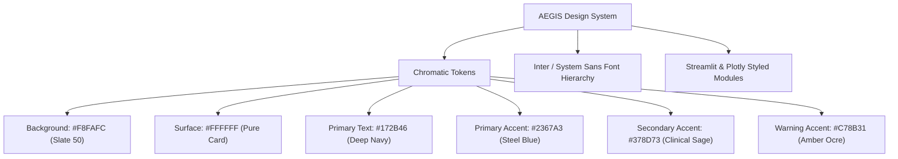
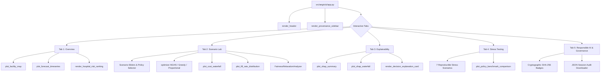
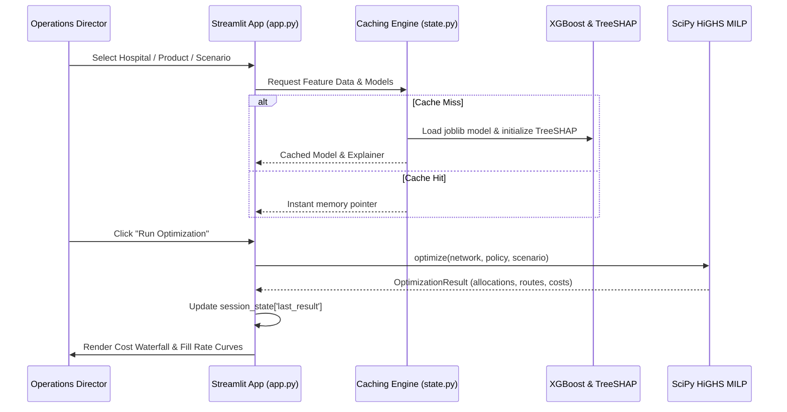

# AEGIS Decision Workspace — UI & Component Architecture

**Milestone 3: Premium Decision Workspace and Explainability**  
**Author:** Lead Product Engineer & Senior Operations Research Architect  
**Status:** Complete & Verified (73 Passing Tests)

---

## 1. Design System & Visual Tokens

The AEGIS Decision Workspace is built on an enterprise-grade, warm-white healthcare logistics aesthetic engineered for cognitive clarity, rapid operational decision-making, and high accessibility.

### 1.1 Color Tokens
| Token | Hex Code | Role | Usage |
| :--- | :--- | :--- | :--- |
| **`BG_APP`** | `#F8FAFC` | App Background | Global canvas background preventing eye strain |
| **`BG_CARD`** | `#FFFFFF` | Surface / Container | Card containers, interactive metrics, Plotly paper |
| **`TEXT_PRIMARY`** | `#172B46` | High-Contrast Typography | Main headings, metric values, table text |
| **`TEXT_MUTED`** | `#64748B` | Secondary Typography | Subheaders, captions, units, timestamps |
| **`ACCENT_PRIMARY`** | `#2367A3` | Primary Action & Logistics | Primary buttons, warehouse markers, demand lines |
| **`ACCENT_SECONDARY`**| `#378D73` | Clinical Priority & Success | High-fill indicators, Level 1 trauma badges, optimal status |
| **`ACCENT_WARNING`**  | `#C78B31` | Shortage & Alert | Stockout risk indicators, relaxation alerts, infeasibility |
| **`BORDER_COLOR`**    | `#E2E8F0` | Structural Separation | Metric card borders, table dividers, tab containers |

### 1.2 Layout Principles
- **No Cyberpunk / Dark Mode Distortions:** Uses a clean clinical palette that matches hospital logistics operations centers.
- **Strict Visual Hierarchy:** Top-level metrics highlight aggregate operational health (Total Demand, Stock on Hand, Expected Shortage, Network Fill Rate), followed by spatial and time-series drilldowns, followed by policy-level decisions.
- **Consistent Elevation & Radii:** Standard 8px/12px border radius with subtle shadows (`0 1px 3px rgba(0,0,0,0.05)`).

---

## 2. Component Hierarchy

---

## 3. State Management & Caching Protocol

The application leverages Streamlit's dual caching architecture to deliver sub-100ms interactive response times while isolating computationally intensive ML and OR operations.

### 3.1 Cache Partitioning Strategy
1. **`@st.cache_resource` (Long-Lived Objects):**
   - [`get_cached_model_and_explainer()`](file:///E:/Projects/aegis/src/aegis/ui/state.py): Loads `models/xgboost_demand.joblib` and initializes `shap.TreeExplainer` exactly once across sessions.
   - [`get_cached_network()`](file:///E:/Projects/aegis/src/aegis/ui/state.py): Instantiates `TransportationNetwork` with deterministic facility coordinates, road distances, and fleet matrices.
   - [`get_cached_scenario_generator()`](file:///E:/Projects/aegis/src/aegis/ui/state.py): Instantiates `ForecastScenarioGenerator` bound to the trained model.
2. **`@st.cache_data` (Dataframes & Serialized Tables):**
   - [`get_cached_featured_data()`](file:///E:/Projects/aegis/src/aegis/ui/state.py): Caches test-set parquet features (`data/processed/featured_data.parquet`).
   - [`get_cached_benchmark_metrics()`](file:///E:/Projects/aegis/src/aegis/ui/state.py): Loads audited benchmark tables (`metrics/optimization_benchmark_summary.csv` and `metrics/paired_policy_differences.csv`).
3. **`st.session_state` (Ephemeral Session State):**
   - `session_state.scenario_params`: Holds active user overrides (surge %, inventory ratio, vehicle capacity, min coverage).
   - `session_state.last_result`: Holds the most recent `OptimizationResult` to allow cross-tab inspection and audit trail export.
   - `session_state.audit_log`: Chronological list of user interventions, optimization executions, solver runtimes, and parameter adjustments.

---

## 4. Tab Implementations

### 4.1 Tab 1: Overview
- **Executive KPI Cards:** Network Forecast Demand (units), Total Warehouse Stock (units), Projected Shortage Risk (units), Minimum Service Coverage (%).
- **Interactive Facility Network Map:** Plotly Cartesian map displaying 20 hospitals (coded by clinical tier: Level 1 Trauma, Regional Referral, Community, Specialty Clinic) and 3 fulfillment warehouses (Central, North, South) with candidate routes.
- **Uncertainty-Aware Demand Forecast:** 55-day chronological test timeline showing actual demand, point forecast ($\hat{y}_{t}$), and the 80% prediction interval ($p_{10}$ to $p_{90}$) generated by quantile regression.
- **Hospital Vulnerability Ranking:** Sortable clinical risk index combining high bed capacity, severe clinical tier weight, and narrow historical buffer stock.

### 4.2 Tab 2: Scenario Lab
- **Real-Time Scenario Sliders:**
  - Demand Surge: $0\%$ to $+100\%$
  - Warehouse Stock Ratio: $20\%$ to $150\%$
  - Vehicle Dispatch Capacity: $100$ to $500$ units/truck
  - Transport Capacity Throttle: $20\%$ to $100\%$
  - Minimum Facility Coverage ($\alpha_{\min}$): $0\%$ to $100\%$
  - Shortage Penalty Multiplier: $0.5\times$ to $5.0\times$
- **Policy Selection:** Proportional Allocation, Demand-Priority Greedy, Deterministic MILP (HiGHS), Stochastic MILP (Two-Stage Recourse).
- **Execution & Infeasibility Handling:**
  - When the solver returns `Infeasible`, the app activates `FairnessRelaxationAnalyzer` to display the exact physical inventory shortfall, the bottleneck category, and the maximum achievable coverage $\alpha_{\text{global}}^*$.
- **Visual Analytics:**
  - Cost Decomposition Waterfall: Transport Costs + Route Activation Fees + Vehicle Dispatch Fees + Recourse Shortage Penalties.
  - Facility Fill Rate Distribution: Highlighting clinical tier protection under constrained supply.

### 4.3 Tab 3: Explainability
- **Demand Forecasting Explainability (TreeSHAP):**
  - Global Feature Importance: Bar chart of top predictive drivers (e.g., `demand_lag_7`, `demand_rolling_7_mean`, `bed_capacity`, `day_of_week`).
  - Local Instance Waterfall: Feature-by-feature additive decomposition for any selected hospital and product on a specific date.
  - Strict Additivity Verification: Confirms $\text{Base Value} + \sum \phi_i = \text{Predicted Demand}$ with sub-$10^{-4}$ numerical error.
- **Operations Research Allocation Explainability:**
  - Distinct explainer translating MILP dual variables, shadow shortages, warehouse binding constraints, and clinical tier penalties into plain-English operational narratives.
  - Counterfactual insights: "What would happen if warehouse throughput increased by 20%?" or "Why was route $W01 \to H04$ deactivated?"

### 4.4 Tab 4: Stress Testing
- **7 Presets Engineered for Healthcare Shocks:**
  1. *40% Warehouse Stock Loss:* Sudden supplier disruption or contaminated batch.
  2. *50% Demand Surge:* Respiratory virus outbreak across regional clinics.
  3. *Route Disruption:* Road closures severing direct transit from the Central Logistics Center.
  4. *50% Vehicle Capacity Reduction:* Driver shortages or vehicle mechanical downtime.
  5. *Infeasible Fairness Target:* Unrealistic policy mandate requiring 95% coverage during a severe stockout.
  6. *Missing Model Artifact Fallback:* Graceful degradation to robust heuristic allocations.
  7. *Solver Timeout Test:* Evaluates behavior under strict sub-second time limits.
- **Audited 4-Policy Benchmark Comparison:** Plotly comparative bar chart grounded in the audited `optimization_benchmark_summary.csv` ($N=30$ instances across 6 regimes).

### 4.5 Tab 5: Responsible AI & Governance
- **Cryptographic Provenance:** Displays dataset SHA-256 hashes, model serialization timestamps, and seed parameters.
- **Ethical Disclaimers:** Explicit banners stating that data is synthetic, non-patient-specific, contains zero PHI/PII, and requires clinical human-in-the-loop sign-off before operational execution.
- **Session Audit Downloader:** Allows one-click export of `aegis_session_audit.json` containing the full trail of run parameters, solver metrics, and timestamps for regulatory compliance.

---

## 5. Verification & Testing Evidence

The UI and explainability architectures are covered by automated unit, integration, and AppTest suites in [`tests/test_ui_and_explainability.py`](file:///E:/Projects/aegis/tests/test_ui_and_explainability.py):

| Test Identifier | Component Tested | Verification Criteria | Status |
| :--- | :--- | :--- | :--- |
| `test_tree_shap_initialization` | `TreeSHAPExplainer` | Model loads and initializes SHAP tree explainer with correct feature names | **PASS** |
| `test_tree_shap_global_importance` | `TreeSHAPExplainer` | Computes global mean absolute SHAP values across 39 features | **PASS** |
| `test_tree_shap_local_waterfall_additivity` | `TreeSHAPExplainer` | Confirms $\text{base} + \sum \phi_i = \hat{y}$ within $10^{-4}$ tolerance | **PASS** |
| `test_decision_explainer_allocation_attribution` | `AllocationDecisionExplainer` | Explains first-stage shipments, route activation, and clinical tier priority | **PASS** |
| `test_decision_explainer_infeasible_relaxation` | `AllocationDecisionExplainer` | Diagnoses infeasible $\alpha_{\min}$ and computes valid relaxed target $\alpha^*$ | **PASS** |
| `test_plot_builders_generate_valid_figures` | `plots.py` | All 7 Plotly visualization functions generate valid `go.Figure` instances | **PASS** |
| `test_missing_artifact_graceful_fallback` | `state.py` | Gracefully handles absent model files without crashing | **PASS** |
| `test_cached_state_loaders` | `state.py` | Caching loaders return valid dataframes, networks, and scenario generators | **PASS** |
| `test_streamlit_app_loads_and_renders` | `app.py` | `AppTest` executes `app.py` headlessly; verifies 5 tabs and zero unhandled exceptions | **PASS** |
| `test_benchmark_metrics_display_not_fabricated` | `plots.py` | Proves UI uses genuine audited benchmark data from M2 audit | **PASS** |
| `test_audit_log_export_schema` | `app.py` | Validates session audit JSON contains all necessary audit fields | **PASS** |
